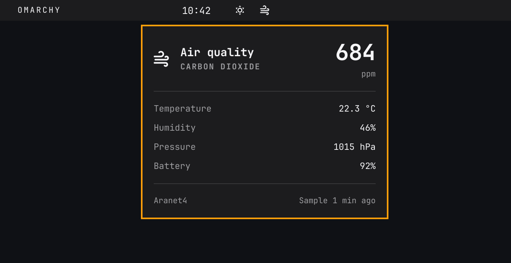
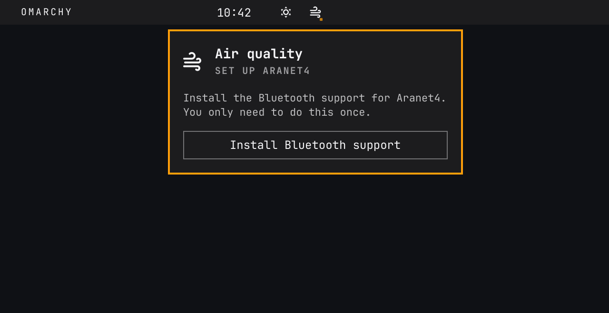

# Aranet4 for Omarchy

An icon-only air quality widget for the Omarchy bar. Click the air icon for a native panel with CO₂ in ppm, temperature (°C), humidity, pressure, sensor battery, and measurement age. After setup, the icon hides after a failed presence check and returns when the sensor is detected again.



*The native widget shown with example sensor readings.*

## Requirements

- Omarchy with the native Quickshell plugin system, a working Bluetooth adapter, and BlueZ. Legacy Waybar configurations are not supported.
- Python 3 and [`uv`](https://docs.astral.sh/uv/) for the one-time dependency setup.
- An Aranet4 with firmware **1.2.0 or newer** and **Smart Home integrations** enabled in the Aranet Home app.

Close the phone app after changing the sensor settings: an active connection from another device can interrupt its broadcasts.

## Install

Add and enable the plugin:

```sh
omarchy plugin add https://github.com/keganhollern/omarchy-aranet4.git --enable
```

Click the air icon with the small setup dot:

1. Enable **Smart Home integrations** in the Aranet Home app, close the app, and keep the monitor nearby.
2. Choose **Install Bluetooth support** to install the pinned Python dependencies and start discovery. If support is already installed, choose **Find my Aranet4**.
3. Select your monitor when discovery finishes. Use **Scan again** if needed.



*The native setup panel rendered with example setup state.*

Dependencies live in an isolated environment at `~/.local/share/omarchy-aranet4/venv/`; system Python packages are not changed. Installation happens only when requested, not during normal refreshes or each shell startup. The selected monitor is saved in Omarchy's bar configuration. A new widget starts in `centerBegin`; move it with Omarchy's bar configuration.

Discovery finishes shortly after finding a monitor with readable data, with a brief window to collect other nearby monitors. If none is ready, it searches for up to 15 seconds. Use **Scan again** if your monitor is not listed.

If you already know the Bluetooth address, you can use this command instead of the panel:

```sh
python ~/.config/omarchy/plugins/kegan.aranet4/install.py --address AA:BB:CC:DD:EE:FF
```

This command also enables the plugin, backs up `~/.config/omarchy/shell.json` before changing it, and preserves an existing widget's bar position. It is safe to rerun. The paths above use the standard XDG directories; setup also honors `XDG_CONFIG_HOME`, `XDG_DATA_HOME`, and `XDG_CACHE_HOME`.

To install a development checkout instead, run `python install.py --address AA:BB:CC:DD:EE:FF` from its directory. This copies its runtime files into the installed plugin directory; rerun that command after editing the development checkout.

## Power and presence

The widget receives Bluetooth advertisements without connecting to the Aranet4 or reading/writing its GATT characteristics. It requests no new measurement: a sensor set to measure every five minutes keeps that cadence independently of the widget.

| Situation | Behavior |
| --- | --- |
| Start, wake, unlock, lid opening, or return from idle | Check immediately once the session is usable. |
| Nearby sensor, active laptop on AC | Check every 5 minutes. |
| Nearby sensor, active laptop on battery | Check every 10 minutes. |
| Power-saver profile | Check every 15 minutes. |
| Sensor absent | Retry after 15 minutes, then 30, then hourly. |
| Asleep, locked/inactive, lid closed, or idle for 5 minutes | Pause background checks. |
| Details panel open | Refresh immediately, then every 5 minutes while open. Closing cancels an unfinished panel refresh. |

Each check stops after the first valid broadcast. Listening windows are limited to 45 seconds, with bounded scanner setup and cleanup. Passive scanning is used when supported; otherwise the worker falls back to active scanning. Actual energy savings depend on the Bluetooth adapter and have not been measured.

Presence reflects the most recent check, not continuous proximity. A successful check keeps the icon visible until the next scheduled check plus a 90-second grace period; a failed check hides it. Moving the laptop or sensor may therefore take time to appear on the bar. The last known reading and its age remain available in the details panel. Open that panel even while the icon is hidden with:

```sh
omarchy-shell shell summon kegan.aranet4 '{}'
```

A manual panel request can refresh while idle or with the lid closed on an external monitor. It never overrides sleep, locking, or an inactive session. Power/session detection uses logind, UPower, power profiles, and Quickshell's idle monitor; available signals depend on the desktop. The plugin creates no wake timers or suspend inhibitors and changes no system power settings.

## Runtime and updates

Omarchy owns a single `Service.qml` instance for the enabled plugin. That service owns one Python worker shared by the widgets on all monitors. Requests and readings travel over bounded JSON lines on stdin/stdout. Disabling or removing the plugin stops its worker; closing stdin also makes the worker exit. There is no separately installed systemd service.

The details panel keeps the previous reading visible during a refresh, with progress shown in its footer. New readings replace it when their timestamps have been checked against the system clock.

The worker runs **directly from the installed plugin checkout**, so a normal update changes the interface and backend together:

```sh
omarchy plugin update kegan.aranet4
```

If an update changes `requirements.txt`, use **Install Bluetooth support** when prompted, or rerun the manual setup command. Restart the shell with `omarchy restart shell` if it retains old plugin code after an update.

Only a private last-reading cache and a per-sensor lock are stored under `~/.cache/omarchy-aranet4/`. There are no control/status files to poll, and no readings are sent to a server. To inspect the worker's current state, latest snapshot, and last error:

```sh
omarchy-shell kegan.aranet4 status
```

When migrating from an earlier version of this project, setup stops and removes only its recognized `omarchy-aranet4.service`. It preserves that unit and obsolete control/status files under `~/.local/share/omarchy-aranet4/migration-backups/`. An unfamiliar service with the same name is left untouched and setup reports the conflict.

## Uninstall

```sh
omarchy plugin disable kegan.aranet4
omarchy plugin remove kegan.aranet4
```

No separate service needs stopping. The Python environment, reading cache, and any migration backups remain as user data. After removal, optionally delete `~/.local/share/omarchy-aranet4/` and `~/.cache/omarchy-aranet4/` if you no longer want them. Review any migration backups before deleting them. Adjust these paths if using custom XDG directories.

## Development

Run the tests from the repository root; Node.js is needed only for the JavaScript tests:

```sh
python -m unittest -v
node test_snapshot.js
node test_setup.js
omarchy plugin validate .
```

The Python and JavaScript tests use synthetic readings and mocked hardware. They cover onboarding, scheduling, power/session changes, rendering, input validation, cache handling, worker shutdown, and the stdin/stdout protocol.

`aranet_setup.py` handles dependency setup and discovery. `aranet_bar.py` handles readings and the worker entry point; `adaptive_reader.py` and `adaptive_policy.py` handle scheduling; `power_state.py` observes system state. `Service.qml` owns the worker, and `AranetWidget.qml` renders the icon and panel.

Licensed under the [MIT License](LICENSE). Bluetooth decoding uses the [Aranet4 Python client](https://github.com/Anrijs/Aranet4-Python).
